# Project Dashboard

See your Obsidian projects across a whole year, then plan each week's tasks in a month view. Edit tasks right from the dashboard.

[繁體中文說明](README.zh-TW.md)

## What is this?

Project Dashboard reads the project notes in one folder. Each project gets one row, and each week gets one cell. Use the year view to see the whole year. Use the month view to read the task text for each week of a month. The dashboard is in Traditional Chinese; the settings tab is in English.

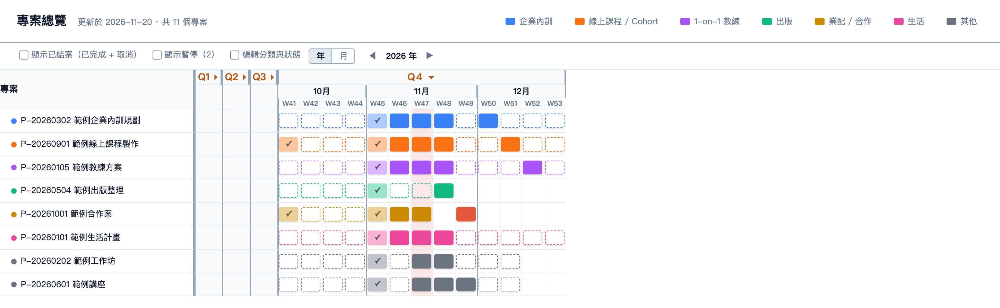

## Install

Requires Obsidian **1.11.7 or later**. Works on computers, tablets, and phones. Tablets show the same views as computers. On a tablet, dragging the legend to reorder categories or dragging the name column's edge to resize it needs a mouse or trackpad.

### With BRAT (recommended)

1. Install and enable BRAT in Obsidian.
2. Run `BRAT: Plugins: Add a beta plugin for testing (with or without version)`.
3. Enter `vizance/obsidian-project-dashboard`.
4. Choose the latest version.
5. Enable Project Dashboard under **Settings → Community plugins**.

### Manually

1. Download `main.js`, `manifest.json`, and `styles.css` from the [latest Release](https://github.com/vizance/obsidian-project-dashboard/releases/latest).
2. Put all three files in `.obsidian/plugins/project-dashboard/` inside your vault.
3. Enable Project Dashboard under **Settings → Community plugins**.

To open it, run `Project Dashboard: Open dashboard` from the command palette. Or click the calendar-range icon in the left ribbon, with the tooltip `Open project dashboard`. If the dashboard is already open, this brings you back to its tab.

## First-time setup

1. Go to **Settings → Project Dashboard → Project notes**.
2. Tap or click `Project folder`. Pick the folder that holds your project notes from the list, or type its path yourself. It starts as `Projects`. Only notes right inside that folder are read; notes in subfolders are skipped.
3. Create a Markdown note there. A name such as `🚧 P-20261102 範例專案.md` works well. `P-` is a naming habit, not a required prefix. The leading symbol sets the status: `🚧 進行中` (active), `⏳ 暫停` (paused), `✅ 完成` (done), or `❌ 取消` (cancelled). No symbol means active.
4. Put the dates in the properties block at the top of the note (frontmatter). Use `開始日期` for the start and `預計結束日期` for the expected end. `實際結束日期` is used as the end only when there is no expected end. Write dates as `YYYY-MM-DD`.
5. Give tasks a date with `📅 YYYY-MM-DD`. A checked box or `✅ YYYY-MM-DD` marks a task as done. Leave an open task without a date to plan it later.

For example, save this as `🚧 P-20261102 範例專案.md`:

```markdown
---
開始日期: 2026-11-02
預計結束日期: 2026-12-18
---

- [ ] 準備讀書會 📅 2026-11-20
- [x] 整理閱讀清單 📅 2026-11-13 ✅ 2026-11-13
- [ ] 寄出邀請
```

Open the dashboard and go to November 2026 to see these tasks. You can type this task format yourself; the Tasks plugin is not required.

See [note names and dates](docs/details.md#note-names-and-dates) for date fallbacks and [task dates](docs/details.md#task-dates) for the full date rules.

## Year view

Each cell shows what is planned for that week:

- **Solid color:** there are tasks, with some still open.
- **Pale color with `✓`:** all tasks for the week are done.
- **Dashed border:** the week is in the project period, with no tasks yet.
- **Blank:** no tasks and outside the project period, or an idle week of a closed project.
- **Red block:** an active or paused project still has tasks in a week beyond its expected end. This stays red even if those tasks are done.

A dated task always appears in its week, including before the start or after the expected end. The expected end only decides whether a task week is red; it never hides a task. Closed projects use grey blocks when shown. Hover over `⚠` beside a name to learn about missing, inferred, or problem dates.

When you open this year's view, past quarters fold into narrow grey columns. Click a heading such as `Q1 ▸` to open that quarter. Click it again to fold it. Your choices stay while you view the same year. Changing years or reopening the tab resets them.

Use `◀ 2026 年 ▶` to move between years and plan next year. When this week's column is out of view, `本週` (this week) appears after these controls. This happens if you scroll it away, fold its quarter, or view another year. Click it to return to this year, open this week's quarter, and scroll this week to the center of the table's visible area.

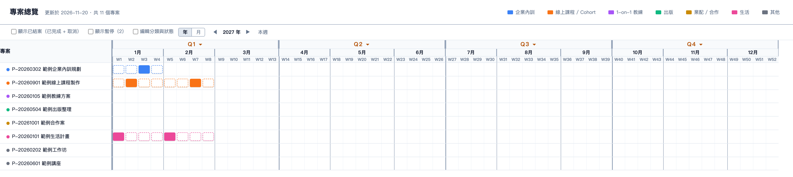

Click `?` at the bottom right to open help. Its tabs are `年視圖` (year view), `月視圖` (month view), and `操作` (actions). It opens on the tab for your current view, with small samples that match the chart.

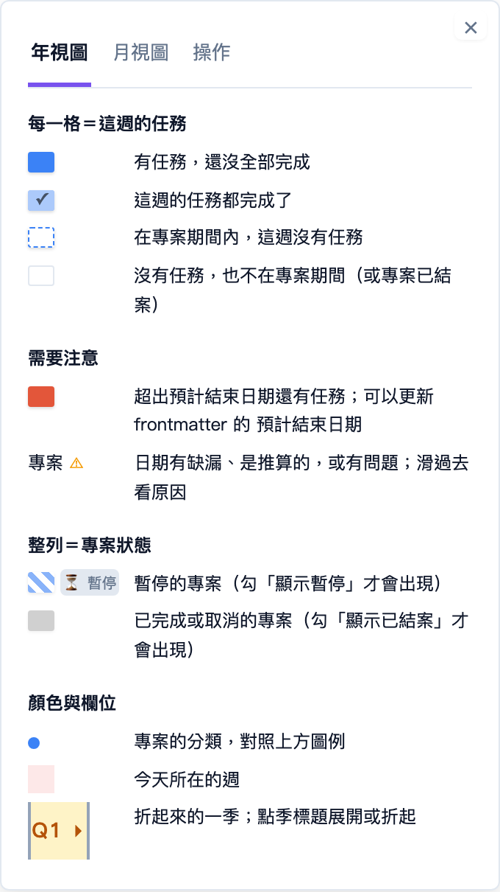

See [year-view rules](docs/details.md#year-view) for week boundaries and the optional Timeline view.

## Week popover

1. Click a week's cell to open its task list. Dashed cells work too.
2. Tick a task done, or untick it. Use `◀` or `▶` beside an open task to move its date by one week.
3. Use `＋ 從還沒排日期的任務挑一個` to pick an undated task, or `＋ 新增任務` to add a task. New dates use Friday by default.
4. Use `↗` to jump to a task's line. Click the project name to open the note on the right.

These actions save straight to the note. In the year view, use the per-week view for editing; Timeline popovers only show text.

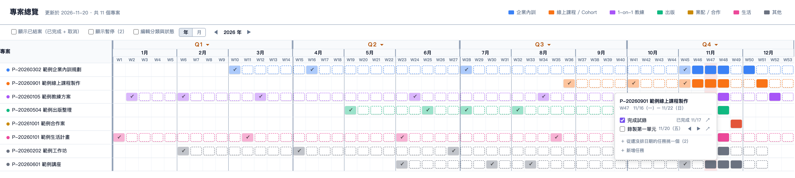

See [popover and editing rules](docs/details.md#week-popover-and-editing) for date choices and protected lines.

## Month view

Click `年` (year) / `月` (month), or press `M`, to switch views. The month view puts task text right in each week's cell. A done task is grey with `✓`. An open task is red once its week has passed. Use `◀` and `▶` to change months; `本月` means “this month” and returns to the month of today's week.

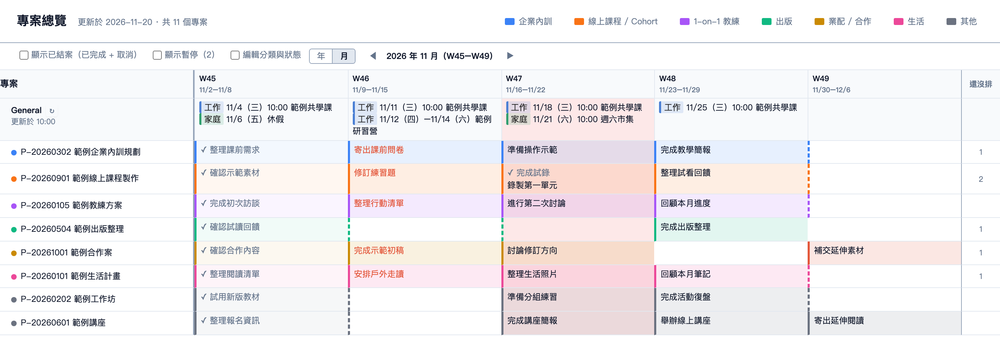

Open `?` here to see the `月視圖` help tab. It explains task text, cell colors, calendar labels, and undated tasks.

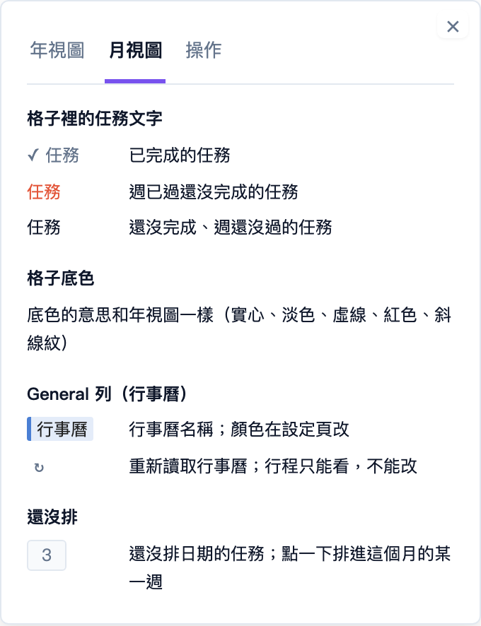

See [month-view rules](docs/details.md#month-view) for how weeks belong to months.

## Unscheduled tasks

The last column, `還沒排` (“not scheduled yet”), counts open tasks with no date. Click a number, then click a week button to put a task into that week of the shown month. The task gets a date in your note. Empty counts stay blank.

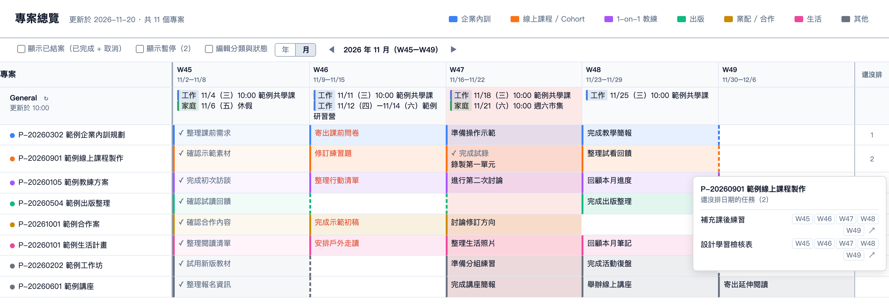

See [unscheduled-task rules](docs/details.md#unscheduled-tasks) for which week buttons you can use.

## General row (calendars)

The month view's top row, `General`, shows calendar events by week. Each event has a label with its calendar's name and color. Events are read-only. Press `↻` to read them again.

Calendar events show only on computers and tablets. On a phone, the plugin does not read calendars.

1. Go to **Settings → Project Dashboard → Calendars**.
2. Press `Add a calendar`.
3. Give it a name. Chinese names work too.
4. Paste its calendar link into the link field. The field clears after saving.
5. Pick a label color if you want.

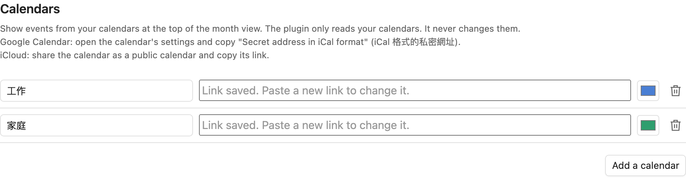

Where to copy the link:

- **Google Calendar:** open **Settings → Settings for my calendars → choose a calendar → Integrate calendar**, and copy **Secret address in iCal format** (`iCal 格式的私密網址`).
- **iCloud:** open Calendar on your Mac, right-click the calendar, choose **Share Calendar…**, turn on **Public Calendar**, and copy the link.
- **A Google calendar subscribed in iCloud:** use the Google link.

Anyone with either link can read that calendar, so keep it private.

Links stay in Obsidian's secret storage, outside the settings carried by Obsidian Sync. Paste the link again on each computer. The field says `This computer has no link yet. Paste it here.` when it is missing there.

See [calendar details](docs/details.md#general-row-and-calendars) for when events are read and what errors mean.

## Paused projects and status changes

Paused projects are hidden by default. Check `顯示暫停（n）` (“show paused,” with a count) to reveal them. Each has a `⏳ 暫停` label and stripes in its category color.

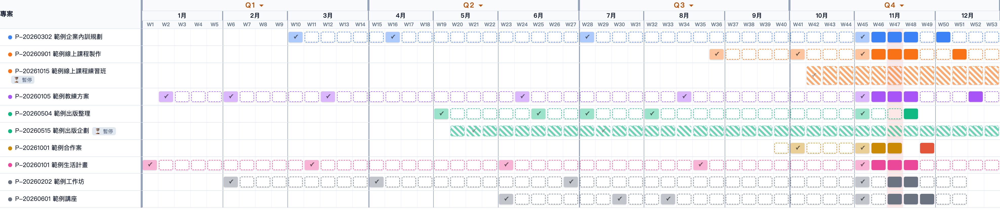

Check `編輯分類與狀態` (“edit category and status”) to show menus on each row. Pick a category or choose active, paused, done, or cancelled. Changing status changes the leading symbol in the note's filename. Use `顯示已結案` (“show closed”) to show done and cancelled projects.

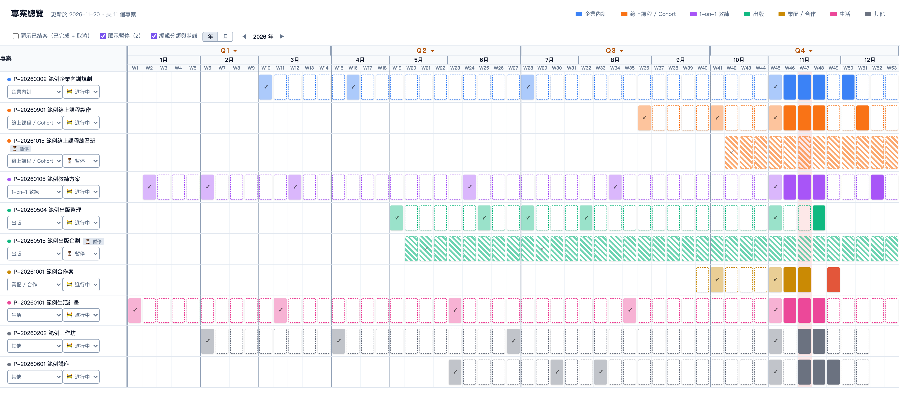

See [status and category rules](docs/details.md#status-and-categories) for name conflicts and link updates.

## On a phone

1. Open the dashboard. It shows the month of today's week, with the table scrolled to this week. The week heading says `本週` (this week). Each project has one row. Each week has one column, with its tasks in the cells, just like the month view on a computer.
2. Hold your phone upright to see about two weeks at a time: this week and next week. Swipe right to see earlier weeks. Swipe left to see later weeks and `還沒排` (not scheduled yet). Project names stay fixed on the left in a 96-pixel column. Each week is at least 120 pixels wide; `還沒排` is 48 pixels wide. As you scroll down, the week headings and month controls stay at the top, so you can always see which week each column shows. The name column hides a leading `P-date` code. For example, `P-20260302 範例企業內訓規劃` shows as `範例企業內訓規劃`. The pop-up title still shows the full name.
3. Turn your phone sideways. If there is enough room, you can see the whole month at once.
4. Use `◀` and `▶` beside a title like `2026 年 11 月（W45–W49）` to change months. Each month change scrolls the table to the top. Other months start at their first week. Tap `本月` (this month) to return to this week; it appears when you view another month. The top row has only these month controls and `顯示暫停（n）` (show paused), when there are paused projects to show.
5. Tap a week cell with tasks or a dashed border to open the same week pop-up as on a computer. Tick or untick a task. Use `◀` or `▶` beside an open task to move it one week. Use `＋ 從還沒排日期的任務挑一個` to pick an undated task, or `＋ 新增任務` to add one. Changes save straight to the note.
6. Swipe to `還沒排` and tap a number. In the pop-up, tap a week button beside a task to put it in that week.
7. Tap a project name in the left column or at the top of a pop-up to open its note. Tap `↗` beside a task to jump to its line. The note opens in the dashboard's own tab. Use Obsidian's back control to return to the dashboard, which opens on this month again with the table scrolled to this week.

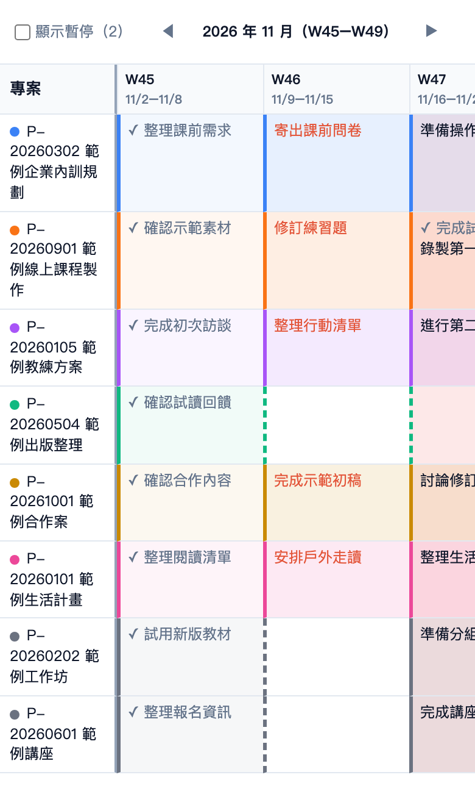

Phones have no year view, year/month switch, Timeline, General calendar row, help panel or `?`, `顯示已結案` (show closed), category or status editing, `⚠` date warnings, or keyboard shortcuts. You cannot drag the legend or resize the name column. Use a computer or tablet for these controls. On a phone, the plugin reads no calendars and makes no network requests.

See [phone month-view rules](docs/details.md#phone-month-view) for the table, task edits, and opening notes.

## Settings

Go to **Settings → Project Dashboard**. There are four sections:

- **Project notes:** choose the project folder and names to skip.
- **Categories:** match words in note names to categories. The first matching rule wins; a category picked by hand wins over the rules.
- **Dates:** choose the day written when you schedule into a week. You can also count Saturday tasks in the following week.
- **Calendars:** add calendar names and links, and choose label colors.

Changes save and update the dashboard on their own. See [all settings](docs/details.md#settings) for the full field list and defaults.

## Network use

On a phone, the plugin makes **no network requests**, even when calendars are set up.

Without a calendar set up, the plugin makes **no network requests**. With calendars set up:

- It reads only the calendar addresses you stored, using `GET` with no body, at [these five times](docs/details.md#when-calendars-are-read).
- It never writes to a calendar. It never creates, changes, or deletes events.
- It sends no notes, settings, or other vault content anywhere.
- Events stay in memory only. They are not saved to disk and are cleared when the plugin unloads.
- Addresses stay in **Obsidian's secret storage**, outside the settings that Obsidian Sync carries. They are never written to plugin data or local storage, or shown in notices, tooltips, error messages, or dashboard text.

## Third-party code

The plugin bundles [ical.js](https://github.com/kewisch/ical.js) **unmodified**, under the [MPL-2.0 license](https://www.mozilla.org/MPL/2.0/). It reads iCalendar files and repeating events. The notice at the top of `main.js` names ical.js, its license, and its [source code](https://github.com/kewisch/ical.js).

## Further reading

These six articles by 朱騏 are in **Traditional Chinese**, in this order: the method, monthly planning, weekly planning, and Obsidian use.

1. [A five-level personal project system](https://chichu.co/blog/5-levels-personal-project-management) — Connect yearly goals to daily tasks on paper.
2. [Eight steps for a monthly plan](https://chichu.co/blog/8-steps-using-google-sheet-to-design-your-monthly-plan) — Break monthly goals into work that fits in your time.
3. [Three steps for weekly planning with a Muji planner](https://chichu.co/blog/3-steps-using-muji-vertical-planner) — Plan and review a week in a paper planner.
4. [Ten steps for a project system in Obsidian](https://chichu.co/blog/10-steps-using-obsidian-to-build-a-personal-project-management-system) — Break goals into quarters and small daily actions.
5. [Turn project lessons into the next task list](https://chichu.co/blog/obsidian-claudian-project-note) — Use Obsidian and Claudian to keep what you learned from a project.
6. [Manage personal projects in Obsidian](https://chichu.co/blog/how-to-use-obsidian-to-manage-personal-project) — Set up notes to manage your own projects.

## Development

```bash
npm install
npm test
npm run lint
npm run build
```

For a test vault, set its location and deploy:

```bash
OBSIDIAN_VAULT="<test-vault-folder>" npm run deploy
```

Or put the location in the ignored `deploy.local.json` as `{ "vault": "<test-vault-folder>" }`, then run `npm run deploy`. It builds and copies the three plugin files into the test vault.

The specs are in [openspec/](openspec/); start with [the vocabulary](openspec/LANGUAGE.md). To retake screenshots with example data, run `npm run screenshots:build`, then `python3 scripts/screenshots/capture.py`. See [AGENTS.md](AGENTS.md#screenshots) for the requirements and image checks.
