# Project Dashboard

把 Obsidian 的專案筆記畫成年視圖與月視圖。看整年的安排，也能直接編輯每週任務。

[English README](README.md)

## 這是什麼

Project Dashboard 讀取一個資料夾裡的專案筆記。一個專案一列，一週一格。年視圖看整年的安排，月視圖直接列出這個月每週的任務文字。儀表板介面是繁體中文，設定頁是英文。

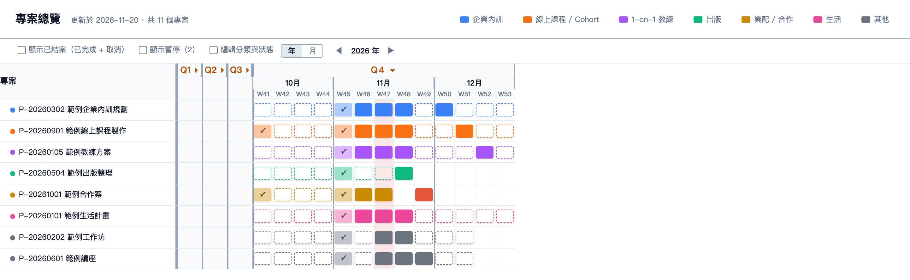

## 安裝

需要 Obsidian **1.11.7 以上版本**。電腦、平板、手機都能用。平板顯示和電腦相同的畫面；在平板上拖拉圖例來調整分類順序，或拖拉名稱欄邊緣來調整寬度，需要滑鼠或觸控板。

### 使用 BRAT（建議）

1. 在 Obsidian 安裝並啟用 BRAT。
2. 執行 `BRAT: Plugins: Add a beta plugin for testing (with or without version)`。
3. 輸入 `vizance/obsidian-project-dashboard`。
4. 選擇最新版本。
5. 到「設定 → 第三方外掛」啟用 Project Dashboard。

### 手動安裝

1. 從 [最新 Release](https://github.com/vizance/obsidian-project-dashboard/releases/latest) 下載 `main.js`、`manifest.json`、`styles.css`。
2. 把三個檔案放進 vault 的 `.obsidian/plugins/project-dashboard/`。
3. 到「設定 → 第三方外掛」啟用 Project Dashboard。

在指令面板執行 `Project Dashboard: Open dashboard` 就能打開儀表板。也可以點左側工具列的日期區間圖示，滑過去會顯示 `Open project dashboard`。已經開過時會回到原本的分頁。

## 第一次設定

1. 到「設定 → Project Dashboard → Project notes」。
2. 在 `Project folder` 填入專案筆記所在的資料夾，預設是 `Projects`。只讀這一層的筆記，子資料夾不會讀取。
3. 在裡面建立 Markdown 筆記，例如 `🚧 P-20261102 範例專案.md`。`P-` 是命名習慣，沒有也能用。開頭符號代表狀態：`🚧 進行中`、`⏳ 暫停`、`✅ 完成`、`❌ 取消`。沒放符號時算進行中。
4. 在筆記最上方的屬性區塊（frontmatter）填入 `開始日期` 與 `預計結束日期`。沒有預計結束日時，會改用 `實際結束日期`。日期寫成 `YYYY-MM-DD`。
5. 任務後面加上 `📅 YYYY-MM-DD` 就能排日期。核取方塊打勾或加上 `✅ YYYY-MM-DD` 表示完成。還沒決定日期的任務先留白。

例如把下面內容存成 `🚧 P-20261102 範例專案.md`：

```markdown
---
開始日期: 2026-11-02
預計結束日期: 2026-12-18
---

- [ ] 準備讀書會 📅 2026-11-20
- [x] 整理閱讀清單 📅 2026-11-13 ✅ 2026-11-13
- [ ] 寄出邀請
```

打開儀表板後切到 2026 年 11 月，就能看到這些任務。可以自己輸入這個格式，不需要先安裝 Tasks 外掛。

詳細規則見 [檔名與日期](docs/details.zh-TW.md#檔名與日期) 及 [任務日期](docs/details.zh-TW.md#任務日期)。

## 年視圖

每一格代表那一週的安排：

- **實心**：有任務，還沒全部完成。
- **淡色加 `✓`**：這週的任務都完成了。
- **虛線**：在專案期間內，這週還沒有任務。
- **空白**：沒有任務且不在專案期間，或是已結案專案沒有任務的那週。
- **紅色實心**：進行中或暫停的專案超出預計結束日期後還有任務。即使任務完成，這個提醒仍然保留。

有日期的任務一律出現在它那一週。開始日期之前、預計結束日期之後也看得到。預計結束日期只決定任務週要不要標紅色，不會把任務藏起來。已結案專案顯示時用灰色。專案名稱旁有 `⚠` 時，滑過去可以看日期缺漏、推算或異常的原因。

用 `◀ 2026 年 ▶` 切換年份，也能先排明年。按 `今年` 回到今年。

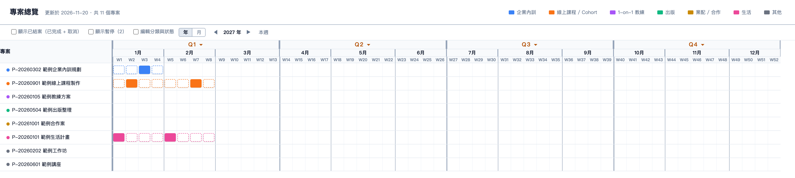

點右下角 `?` 打開說明面板。裡面有 `年視圖`、`月視圖`、`操作` 三個分頁，會先顯示目前視圖的分頁。每項說明都有和畫面相同的小示範。

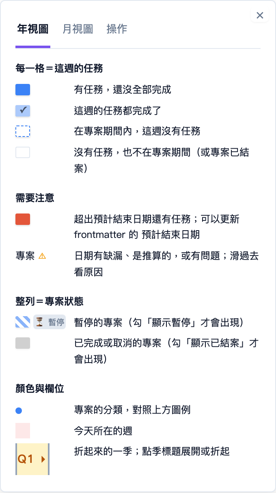

詳細規則見 [年視圖](docs/details.zh-TW.md#年視圖)，包含週的邊界與 Timeline 模式。

## 週浮窗

1. 點週格子打開任務清單，虛線格子也能點。
2. 勾選任務完成或取消勾選。用未完成任務旁的 `◀`、`▶` 把日期往前或往後移一週。
3. 點 `＋ 從還沒排日期的任務挑一個`，或用 `＋ 新增任務` 直接新增。預設會寫入那週星期五的日期。
4. 按 `↗` 跳到筆記裡的任務行。點專案名稱則在右側打開筆記。

改動會直接存回筆記。年視圖要在逐週模式才能編輯，Timeline 浮窗只顯示文字。

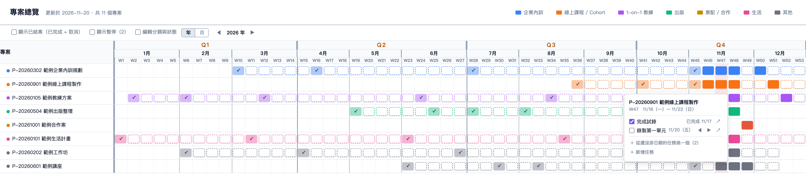

日期選擇與不能修改的內容，見 [週浮窗與編輯](docs/details.zh-TW.md#週浮窗與編輯)。

## 月視圖

按 `年`／`月` 或 `M` 切換。月視圖的格子直接列出任務文字。已完成是灰色加 `✓`，週已過卻還沒完成是紅字。用 `◀`、`▶` 換月份，按 `本月` 回到今天這週所屬的月份。

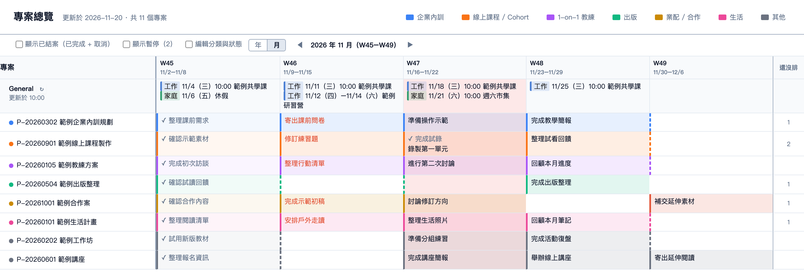

在這裡打開 `?`，會先看到 `月視圖` 分頁。裡面說明任務文字、格子底色、行事曆標籤與還沒排的任務。

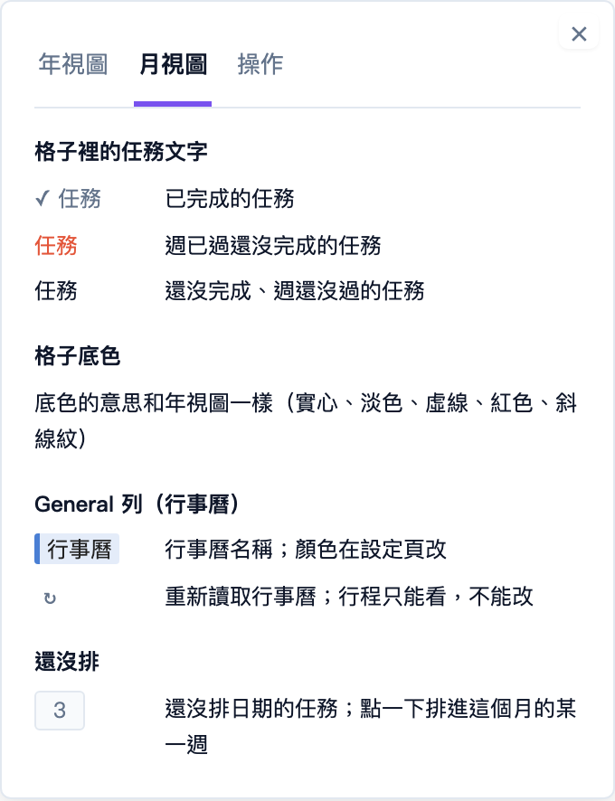

每一週算在哪個月，見 [月視圖](docs/details.zh-TW.md#月視圖)。

## 還沒排

最後一欄 `還沒排` 的數字是還沒安排日期的未完成任務。點數字打開清單，再按某一週的按鈕就能排進去。可選的是目前顯示月份的週，日期會直接寫回筆記。沒有任務時留白。

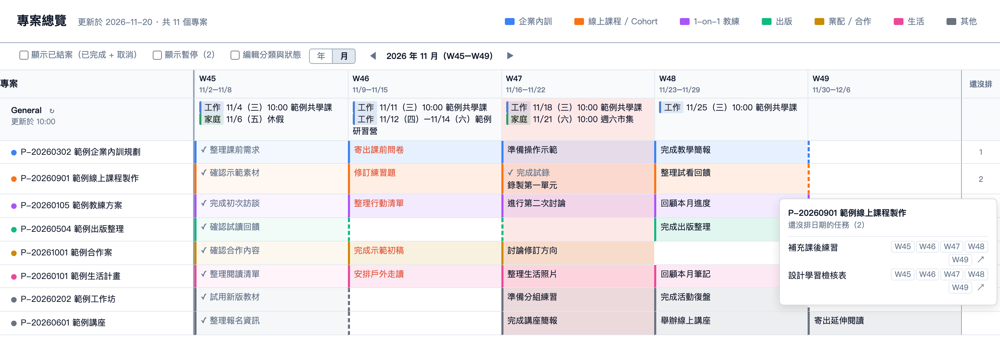

哪些週按鈕可以選，見 [還沒排](docs/details.zh-TW.md#還沒排)。

## General 列（行事曆）

月視圖最上面的 `General` 列會逐週顯示行程。每筆行程前面有行事曆名稱標籤與顏色。行程只能看不能改，按 `↻` 可以重新讀取。

行事曆行程只在電腦與平板上顯示，手機上不讀行事曆。

1. 到「設定 → Project Dashboard → Calendars」。
2. 按 `Add a calendar`。
3. 給行事曆取名，可以打中文。
4. 把行事曆連結貼進連結欄。存好後欄位會清空。
5. 想換標籤顏色時，用顏色選擇器調整。

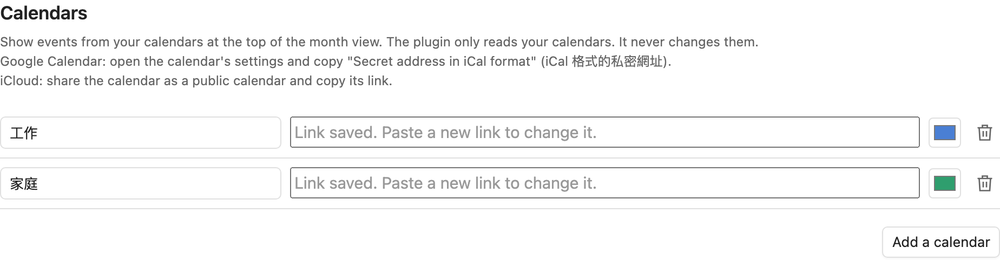

連結從哪裡複製：

- **Google 日曆**：到「設定 → 我的日曆設定 → 選擇日曆 → 整合日曆」，複製「iCal 格式的私密網址」（英文介面是 **Secret address in iCal format**）。
- **iCloud**：在 Mac 的行事曆對該行事曆按右鍵，選「共享行事曆⋯」，勾選「公開行事曆」再複製連結。
- **iCloud 裡訂閱的 Google 日曆**：請用 Google 的連結。

任何拿到這兩種連結的人都能讀取該行事曆，請不要分享出去。

連結存在 Obsidian 的密鑰儲存區，不會進入 Obsidian Sync 同步的設定。另一台電腦要再貼一次。那台電腦缺少連結時，欄位會顯示 `This computer has no link yet. Paste it here.`。

讀取時機與錯誤原因，見 [General 列與行事曆](docs/details.zh-TW.md#general-列與行事曆)。

## 暫停的專案與改狀態

暫停的專案預設隱藏。勾 `顯示暫停（n）` 才會出現，數字表示可顯示的暫停專案數量。名稱後面有 `⏳ 暫停` 標籤，色條會加上分類色的斜線紋。

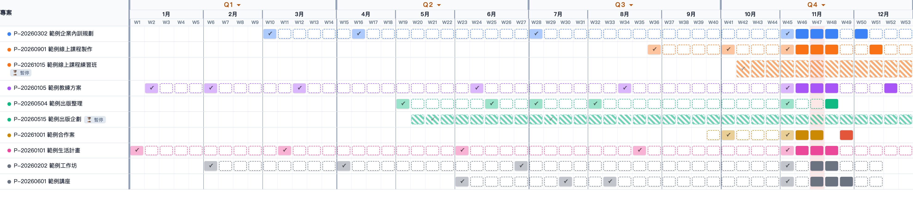

勾 `編輯分類與狀態`，每列就會顯示分類與狀態選單。可以改分類，也能改成進行中、暫停、完成或取消。外掛會替你改檔名開頭的符號。想看完成或取消的專案，勾 `顯示已結案`。

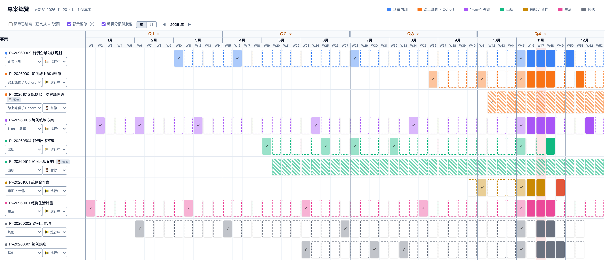

同名筆記與連結更新的處理方式，見 [狀態與分類](docs/details.zh-TW.md#狀態與分類)。

## 在手機上

在手機打開儀表板，會看到由上往下的清單：`本週`、`下週` 與後面 2 週。每週照專案分組列出任務。沒有任務的週會寫 `這週沒有任務`。

1. 勾選任務表示完成。任務會留在原本那週，變成灰字並保持打勾；取消勾選就能復原。重複任務要到筆記裡勾選。
2. 用未完成任務旁的 `◀`、`▶`，把日期往前或往後移一週。移出這 4 週時，會跳出提示告訴你移到哪裡。
3. 清單上方有 `之前還沒做（n）` 時，點一下展開之前幾週還沒完成的任務。按任務旁的 `排到本週`，日期就會改成本週的排程日期。寫星期幾依「設定 → Project Dashboard → Dates → `Which day to write`」，預設星期五。在這一區打勾的任務會先留著，直到收起這一區或重新打開儀表板分頁，按錯了可以當場取消。
4. 點專案名稱，在同一個分頁打開筆記。按 Obsidian 的返回，就能回到儀表板。

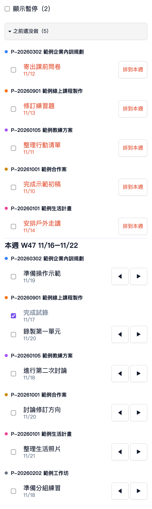

手機清單沒有行事曆、年視圖與月視圖、分類與狀態編輯，也沒有說明面板。不能在清單裡新增任務，或把還沒排日期的任務排進來。這些任務修改請打開筆記處理，其他視圖與控制請用電腦或平板。

週的邊界、寫入日期、提示文字與舊任務的保留方式，見 [手機週清單](docs/details.zh-TW.md#手機週清單)。

## 設定頁

到「設定 → Project Dashboard」可以看到四個區塊：

- **Project notes（專案資料夾）**：選擇專案資料夾，填入要略過的檔名片段。
- **Categories（分類規則）**：用檔名裡的文字決定分類。由上往下第一個符合的規則生效，手動指定的分類優先。
- **Dates（週與日期）**：選擇排進某週時要寫星期幾。也能讓週六任務算到下一週。
- **Calendars（行事曆）**：加入行事曆名稱與連結，選擇名稱標籤的顏色。

修改後會自動儲存，儀表板也會更新。完整欄位與預設值見 [設定](docs/details.zh-TW.md#設定)。

## 連網說明

在手機上，即使已設定行事曆，外掛也**不發任何網路請求**。

沒有設定行事曆時，外掛**完全不連網**。設定行事曆後：

- 只讀取你自己存入的行事曆網址。使用沒有內容的 `GET` 請求，限於 [這五個時機](docs/details.zh-TW.md#行事曆讀取時機)。
- 絕不寫入行事曆，不新增、修改或刪除行程。
- 不會送出任何筆記、設定或其他 vault 內容。
- 讀回的行程只放在記憶體，不寫進硬碟。外掛卸載時就會清除。
- 網址存在 **Obsidian 的密鑰儲存區**，不會進入 Obsidian Sync 同步的設定。不寫進外掛資料或本機偏好，也不出現在通知、提示、錯誤訊息與儀表板文字裡。

## 第三方程式碼

外掛包含 [ical.js](https://github.com/kewisch/ical.js)，採 [MPL-2.0 授權](https://www.mozilla.org/MPL/2.0/)，未修改原始程式。它負責讀取 iCalendar 檔案與重複行程。`main.js` 開頭的註解也列出 ical.js、授權與 [原始碼位置](https://github.com/kewisch/ical.js)。

## 延伸閱讀

以下是朱騏介紹這套方法的 6 篇文章，依方法論、月計畫、週計畫與 Obsidian 實作排列。

1. [從年目標(數位)到日任務(紙本)的 5 層管理架構！打磨 10 年，這是我同時管理 10 個專案的個人專案管理系統](https://chichu.co/blog/5-levels-personal-project-management)
2. [怎麼安排一個「做得到的月目標」？8 步驟教你使用 Google Sheet 把月計畫拆得剛剛好 (可視化你的專案和任務)](https://chichu.co/blog/8-steps-using-google-sheet-to-design-your-monthly-plan)
3. [一週結束總是覺得自己沒做什麼？3 步驟使用 Muji 手帳掌握週計畫，時間管理新手也能立刻上手!](https://chichu.co/blog/3-steps-using-muji-vertical-planner)
4. [新年訂了新目標，但總是做不到？10 步驟用 Obsidian 打造「季拆解」系統，把抽象目標變成每天 25 分鐘的具體行動](https://chichu.co/blog/10-steps-using-obsidian-to-build-a-personal-project-management-system)
5. [專案做完就忘光踩過的坑？6 步驟教你用 Obsidian＋Claudian 把經驗變成下次的任務清單](https://chichu.co/blog/obsidian-claudian-project-note)
6. [如何使用 Obsidian 管理個人專案 ?](https://chichu.co/blog/how-to-use-obsidian-to-manage-personal-project)

## 開發

```bash
npm install
npm test
npm run lint
npm run build
```

要部署到測試 vault，先指定它的位置：

```bash
OBSIDIAN_VAULT="<test-vault-folder>" npm run deploy
```

也可以在忽略的本機設定檔 `deploy.local.json` 填入 `{ "vault": "<test-vault-folder>" }`，再執行 `npm run deploy`。它會建置並把三個外掛檔案複製進測試 vault。

規格在 [openspec/](openspec/)，可先讀 [詞彙表](openspec/LANGUAGE.md)。重拍範例截圖時，依序執行 `npm run screenshots:build` 與 `python3 scripts/screenshots/capture.py`。所需工具與圖片檢查方式見 [AGENTS.md](AGENTS.md#screenshots)。
